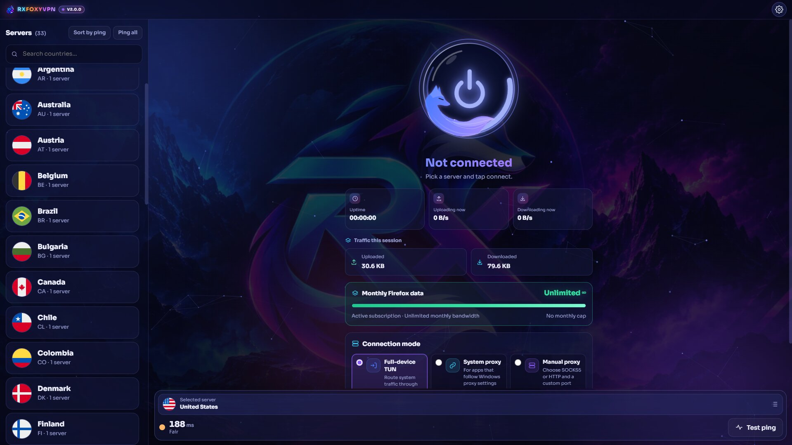
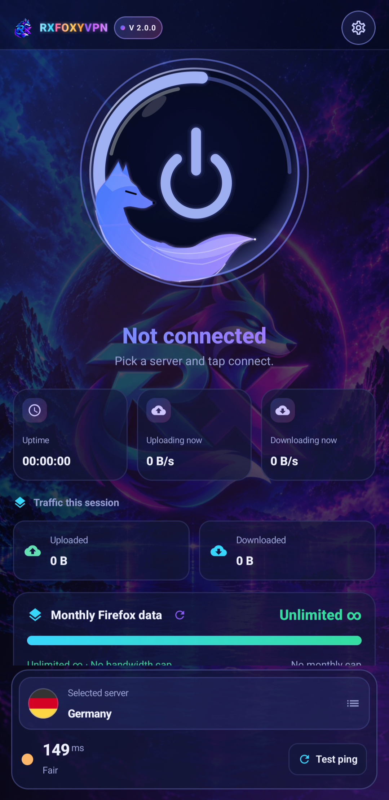
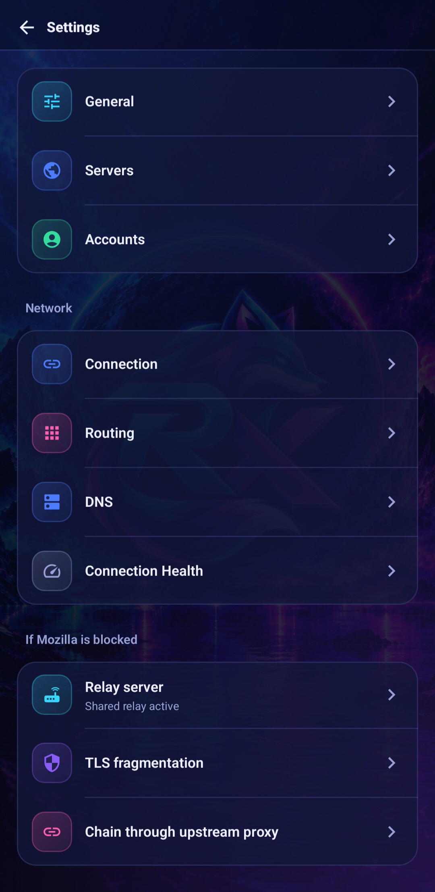

<div align="center" dir="rtl">


# RXFoxyVPN

**حريتك، أولويتنا.**

عميل VPN سريع وأنيق ومتعدد اللغات لنظامي **Android** و**Windows**.

<br>

[](https://github.com/omidrx0/RxFoxyVPN/releases/tag/V2.0.0)
[](https://github.com/SagerNet/sing-box)
[](https://github.com/omidrx0/RxFoxyVPN/releases/tag/V2.0.0)
[](https://github.com/omidrx0/RxFoxyVPN/releases/tag/V2.0.0)
[](https://github.com/omidrx0/RxFoxyVPN/releases/tag/V2.0.0)
[](https://github.com/omidrx0/RxFoxyVPN)
[](https://github.com/omidrx0/RxFoxyVPN)

<br>

[**التنزيل**](https://github.com/omidrx0/RxFoxyVPN/releases/tag/V2.0.0) · [الشيفرة المصدرية](https://github.com/omidrx0/RxFoxyVPN)

[English](../README.md) · [فارسی](README.fa.md) · [Русский](README.ru.md) · [简体中文](README.zh.md) · [한국어](README.ko.md) · **العربية**

</div>

---

<div dir="rtl">

## نظرة عامة

RXFoxyVPN مشروع متعدد المنصات لنظامي **Android** و**Windows**، بواجهة بسيطة وموحدة تتحدث لغتك. يضم هذا المستودع الشيفرة المصدرية والوثائق، وتُنشر النسخ الجاهزة للاستخدام على صفحة [GitHub Releases](https://github.com/omidrx0/RxFoxyVPN/releases/tag/V2.0.0).

### الجديد في الإصدار v2.0.0
> **نواة جديدة · تجربة جديدة · اتصال أفضل**

- **تطور النواة** — انتقال كامل لنواة التطبيق إلى **Sing-box** واستبدال النواة السابقة. تحسين الأداء واستقرار الاتصالات، الاستفادة من ميزات Sing-box المتقدمة، وإضافة نظام مكافحة الرقابة (Anti-Censorship).
- **إدارة حسابات ذكية** — نظام تسجيل دخول ومصادقة جديد، نظام تجمع الحسابات (Account Pool). التبديل التلقائي بين الحسابات عند وصول الاستخدام إلى عتبة 95%. إدارة أفضل للسعة والاستهلاك.
- **توجيه ذكي حسب المنطقة** — إمكانية اختيار منطقة التوجيه. اختيار البلد المطلوب لتوجيه حركة المرور الخاصة به مباشرة (تجاوز نفق VPN).
- **تجديد واجهة أندرويد** — إعادة تصميم أساسية لصفحة الإعدادات وقائمة الخوادم، تحسينات على الشاشة الرئيسية، وتجربة مستخدم أكثر تناسقاً.
- **إعادة تصميم واجهة ويندوز** — واجهة ويندوز معاد تصميمها بالكامل، أقرب بصرياً إلى إصدار أندرويد لتجربة موحدة عبر المنصات.
- **تجربة مستخدم أفضل** — إعادة كتابة رسائل الخطأ لتكون أسهل فهماً، وتحويل الأخطاء التقنية إلى رسائل مفهومة، وتحسين الإرشاد عند حدوث مشاكل.
- **الاستقرار والتحسينات** — إصلاح عدد من الأخطاء من الإصدارات السابقة وتحسين الاستقرار العام.

## الميزات

| Android | Windows |
| --- | --- |
| خدمة VPN أصلية لإدارة الاتصال | واجهة سطح مكتب مع تكامل علبة النظام |
| شاشات الرئيسية وقائمة الخوادم والإعدادات | واجهة قائمة على الويب داخل غلاف سطح المكتب |
| يدعم Android 8.0 وما فوق | وضع TUN على مستوى النظام ودعم وكيل النظام |

**على المنصتين:** واجهة بالإنجليزية والفارسية والروسية والصينية المبسطة والكورية والعربية.

> [!TIP]
> تواجه مشكلة في الاتصال؟ يمكنك [**إنشاء ترحيل شخصي**](relay/README.md).

## لقطات الشاشة

### Windows

<div align="center">
  
</div>

### Android

الحد الأدنى للإصدار المدعوم: **Android 8.0**.

<div align="center">
  <table width="100%">
    <tr>
      <td align="center" width="33%"><a href="screenshots/Home.jpg"></a></td>
      <td align="center" width="33%"><a href="screenshots/Server%20list.jpg"></a></td>
      <td align="center" width="33%"><a href="screenshots/Settings.jpg"></a></td>
    </tr>
    <tr>
      <td align="center"><sub><b>الرئيسية</b></sub></td>
      <td align="center"><sub><b>قائمة الخوادم</b></sub></td>
      <td align="center"><sub><b>الإعدادات</b></sub></td>
    </tr>
  </table>
</div>

## التنزيل · v2.0.0

احصل على أحدث إصدار من <a href="https://github.com/omidrx0/RxFoxyVPN/releases/tag/V2.0.0"><b>GitHub Releases</b></a> أو اختر الحزمة الأنسب لجهازك.

<table dir="rtl">
  <thead>
    <tr>
      <th align="center">المنصة</th>
      <th align="center">&nbsp;&nbsp;&nbsp;&nbsp;&nbsp;&nbsp;&nbsp;&nbsp;&nbsp;&nbsp;&nbsp;&nbsp;&nbsp;&nbsp;&nbsp;&nbsp;&nbsp;التنزيل&nbsp;&nbsp;&nbsp;&nbsp;&nbsp;&nbsp;&nbsp;&nbsp;&nbsp;&nbsp;&nbsp;&nbsp;&nbsp;&nbsp;&nbsp;&nbsp;&nbsp;</th>
    </tr>
  </thead>
  <tbody>
    <tr>
      <td rowspan="5" align="center" valign="middle">
        <br>
        <sub>Android 8.0 أو أحدث</sub>
      </td>
      <td align="center" valign="middle">
        <a href="https://github.com/omidrx0/RxFoxyVPN/releases/download/V2.0.0/app-universal-releaseV2.0.0.apk"></a><br>
        <b>الخيار الأفضل إن لم تكن متأكدًا.</b> ⭐<br><sub>يعمل على جميع الأجهزة والمعماريات.</sub>
      </td>
    </tr>
    <tr>
      <td align="center" valign="middle">
        <a href="https://github.com/omidrx0/RxFoxyVPN/releases/download/V2.0.0/app-arm64-v8a-releaseV2.0.0.apk"></a><br>
        الهواتف واللوحيات الحديثة.<br><sub>معالجات ARM بنظام 64 بت.</sub>
      </td>
    </tr>
    <tr>
      <td align="center" valign="middle">
        <a href="https://github.com/omidrx0/RxFoxyVPN/releases/download/V2.0.0/app-armeabi-v7a-releaseV2.0.0.apk"></a><br>
        أجهزة Android القديمة.<br><sub>معالجات ARM بنظام 32 بت.</sub>
      </td>
    </tr>
    <tr>
      <td align="center" valign="middle">
        <a href="https://github.com/omidrx0/RxFoxyVPN/releases/download/V2.0.0/app-x86_64-releaseV2.0.0.apk"></a><br>
        أجهزة Intel/AMD والمحاكيات.<br><sub>64 بت.</sub>
      </td>
    </tr>
    <tr>
      <td align="center" valign="middle">
        <a href="https://github.com/omidrx0/RxFoxyVPN/releases/download/V2.0.0/app-x86-releaseV2.0.0.apk"></a><br>
        أجهزة Intel/AMD والمحاكيات.<br><sub>32 بت.</sub>
      </td>
    </tr>
    <tr>
      <td rowspan="2" align="center" valign="middle">
        <br>
        <sub>Windows 10 أو أحدث</sub>
      </td>
      <td align="center" valign="middle">
        <a href="https://github.com/omidrx0/RxFoxyVPN/releases/download/V2.0.0/RXFoxyVPN-Setup.exe"></a><br>
        <b>مثبّت قياسي لأجهزة 64 بت.</b> ⭐<br><sub>يضيف الاختصارات ويسهّل إزالة التثبيت.</sub>
      </td>
    </tr>
    <tr>
      <td align="center" valign="middle">
        <a href="https://github.com/omidrx0/RxFoxyVPN/releases/download/V2.0.0/RXFOXYVPN-Windows.zip"></a><br>
        لا يحتاج إلى تثبيت.<br><sub>فك ضغط ملف ZIP ثم شغّل التطبيق.</sub>
      </td>
    </tr>
  </tbody>
</table>

> [!TIP]
> إذا لم تكن متأكدًا من معمارية Android المناسبة، فاختر **Universal**. وإذا طلب Android ذلك، فاسمح بالتثبيت من المتصفح أو مدير الملفات.

> [!NOTE]
> إذا لم يظهر لك المستودع أو الإصدارات فقد يكون الوصول مقيّدًا؛ اطلب الصلاحية من مسؤول المشروع.

## البناء من المصدر

<details>
<summary>عرض خطوات البناء</summary>

<br>

انسخ المستودع:

<div dir="ltr">

```bash
git clone https://github.com/omidrx0/RxFoxyVPN.git
cd RxFoxyVPN
```

</div>

- **Android**: افتح المجلد `Android/` في Android Studio وانتظر اكتمال مزامنة Gradle (راجع ملفات Gradle لمعرفة إصدارات JDK وAndroid SDK المطلوبة)، ثم شغّل التطبيق أو استخدم *Build → Build APK(s)*.
- **Windows**: كُتب تطبيق Windows الجديد باستخدام Go. راجع الشيفرة المصدرية وتعليمات البناء الخاصة بـ Windows في المستودع، واتبع متطلبات Go وبناء واجهة الويب المحددة في إعدادات المشروع.

قد تختلف خطوات البناء حسب بيئتك، وتبقى ملفات الإعداد في المستودع هي المرجع.

</details>

## هيكل المشروع

<div dir="ltr">

```text
Android/    تطبيق Android (Kotlin / Gradle)
Windows/    تطبيق Windows (Go / واجهة ويب)
docs/       ملفات README المترجمة
```

</div>

## المساهمة

نرحب بالاقتراحات وتقارير الأخطاء وطلبات الدمج (Pull Requests). للتغييرات الكبيرة، يُرجى فتح Issue أولًا لمناقشة الفكرة.

## الترخيص

تُحدَّد شروط الاستخدام وإعادة التوزيع في ملف `LICENSE` بالمستودع. وإن لم يوجد، فجميع الحقوق محفوظة للمؤلف.

</div>

---

<div align="center" dir="rtl">

<sub>**RXFoxyVPN** · Android وWindows · [مستودع GitHub](https://github.com/omidrx0/RxFoxyVPN)</sub>

<sub><i>حريتك، أولويتنا.</i></sub>

</div>
