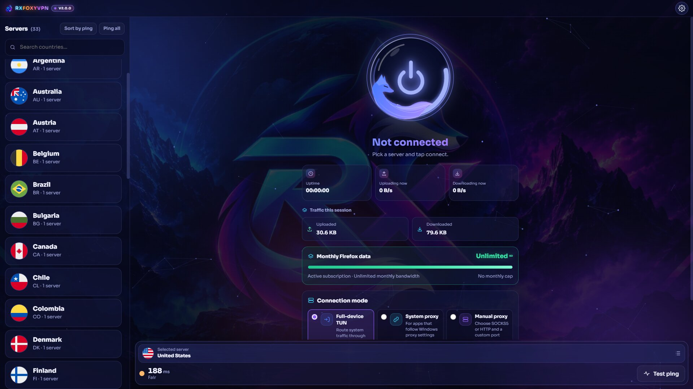
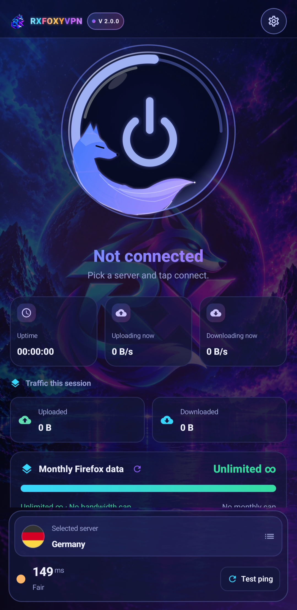
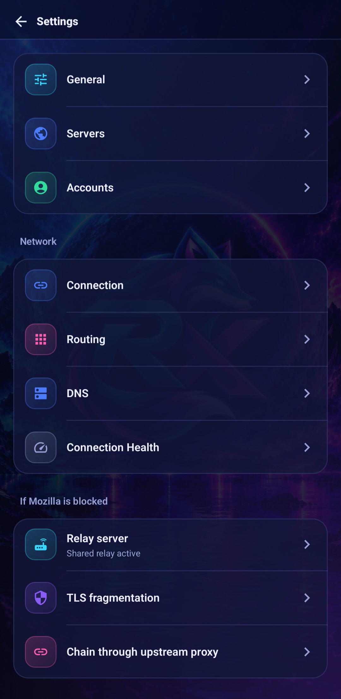

<div align="center">


# RXFoxyVPN

**Ваша свобода — наш приоритет.**

Быстрый, аккуратный и многоязычный VPN-клиент для **Android** и **Windows**.

<br>

[](https://github.com/omidrx0/RxFoxyVPN/releases/tag/V2.0.0)
[](https://github.com/SagerNet/sing-box)
[](https://github.com/omidrx0/RxFoxyVPN/releases/tag/V2.0.0)
[](https://github.com/omidrx0/RxFoxyVPN/releases/tag/V2.0.0)
[](https://github.com/omidrx0/RxFoxyVPN/releases/tag/V2.0.0)
[](https://github.com/omidrx0/RxFoxyVPN)
[](https://github.com/omidrx0/RxFoxyVPN)

<br>

[**Загрузки**](https://github.com/omidrx0/RxFoxyVPN/releases/tag/V2.0.0) · [Исходный код](https://github.com/omidrx0/RxFoxyVPN)

[English](../README.md) · [فارسی](README.fa.md) · **Русский** · [简体中文](README.zh.md) · [한국어](README.ko.md) · [العربية](README.ar.md)

</div>

---

## Обзор

RXFoxyVPN — кроссплатформенный проект для **Android** и **Windows** с простым и единым интерфейсом на вашем языке. В репозитории находятся исходный код и документация; готовые сборки публикуются на странице [GitHub Releases](https://github.com/omidrx0/RxFoxyVPN/releases/tag/V2.0.0).

### Что нового в v2.0.0
> **НОВОЕ ЯДРО · НОВЫЙ ОПЫТ · ЛУЧШЕЕ СОЕДИНЕНИЕ**

- **Эволюция ядра** — Полный переход ядра приложения на **Sing-box** с заменой предыдущего. Улучшена производительность и стабильность соединений, используются расширенные возможности Sing-box, добавлена система Anti-Censorship.
- **Умное управление аккаунтами** — Новая система входа и аутентификации, пул аккаунтов (Account Pool). Автоматическое переключение между аккаунтами при достижении 95% использования. Улучшенное управление ёмкостью и потреблением.
- **Умная маршрутизация** — Маршрутизация по региону. Возможность выбора страны для прямого маршрутизации её трафика (обход VPN-туннеля).
- **Обновление UI Android** — Существенный редизайн экрана настроек и списка серверов, улучшения главной страницы, более согласованный UX.
- **Редизайн UI Windows** — Полностью переработанный интерфейс Windows, визуально ближе к Android, более единообразный опыт между платформами.
- **Улучшенный UX** — Переписаны сообщения об ошибках для лучшего понимания, технические ошибки преобразованы в понятные сообщения, улучшены подсказки при проблемах.
- **Стабильность и улучшения** — Исправлен ряд ошибок предыдущих версий, повышена общая стабильность.

## Возможности

| Android | Windows |
| --- | --- |
| Нативная VPN-служба для управления подключением | Настольный интерфейс с интеграцией в системный трей |
| Экраны: главный, список серверов и настройки | Веб-интерфейс в настольной оболочке |
| Поддержка Android 8.0 и выше | Системный режим TUN и поддержка системного прокси |

**Обе платформы:** интерфейс на английском, персидском, русском, упрощённом китайском, корейском и арабском языках.

> [!TIP]
> Проблемы с подключением? Вы можете [**создать личный релей**](relay/README.md).

## Скриншоты

### Windows

<div align="center">
  
</div>

### Android

Минимальная поддерживаемая версия: **Android 8.0**.

<div align="center">
  <table width="100%">
    <tr>
      <td align="center" width="33%"><a href="screenshots/Home.jpg"></a></td>
      <td align="center" width="33%"><a href="screenshots/Server%20list.jpg"></a></td>
      <td align="center" width="33%"><a href="screenshots/Settings.jpg"></a></td>
    </tr>
    <tr>
      <td align="center"><sub><b>Главный экран</b></sub></td>
      <td align="center"><sub><b>Список серверов</b></sub></td>
      <td align="center"><sub><b>Настройки</b></sub></td>
    </tr>
  </table>
</div>

## Загрузки · v2.0.0

Последнюю сборку можно скачать на <a href="https://github.com/omidrx0/RxFoxyVPN/releases/tag/V2.0.0"><b>GitHub Releases</b></a> — или выберите пакет, подходящий вашему устройству.

<table>
  <thead>
    <tr>
      <th align="center">Платформа</th>
      <th align="center">&nbsp;&nbsp;&nbsp;&nbsp;&nbsp;&nbsp;&nbsp;&nbsp;&nbsp;&nbsp;&nbsp;&nbsp;&nbsp;&nbsp;&nbsp;&nbsp;&nbsp;Загрузка&nbsp;&nbsp;&nbsp;&nbsp;&nbsp;&nbsp;&nbsp;&nbsp;&nbsp;&nbsp;&nbsp;&nbsp;&nbsp;&nbsp;&nbsp;&nbsp;&nbsp;</th>
    </tr>
  </thead>
  <tbody>
    <tr>
      <td rowspan="5" align="center" valign="middle">
        <br>
        <sub>Android 8.0 и выше</sub>
      </td>
      <td align="center" valign="middle">
        <a href="https://github.com/omidrx0/RxFoxyVPN/releases/download/V2.0.0/app-universal-releaseV2.0.0.apk"></a><br>
        <b>Лучший выбор, если не уверены.</b> ⭐<br><sub>Работает на всех устройствах и архитектурах.</sub>
      </td>
    </tr>
    <tr>
      <td align="center" valign="middle">
        <a href="https://github.com/omidrx0/RxFoxyVPN/releases/download/V2.0.0/app-arm64-v8a-releaseV2.0.0.apk"></a><br>
        Современные телефоны и планшеты.<br><sub>64-битные процессоры ARM.</sub>
      </td>
    </tr>
    <tr>
      <td align="center" valign="middle">
        <a href="https://github.com/omidrx0/RxFoxyVPN/releases/download/V2.0.0/app-armeabi-v7a-releaseV2.0.0.apk"></a><br>
        Старые устройства Android.<br><sub>32-битные процессоры ARM.</sub>
      </td>
    </tr>
    <tr>
      <td align="center" valign="middle">
        <a href="https://github.com/omidrx0/RxFoxyVPN/releases/download/V2.0.0/app-x86_64-releaseV2.0.0.apk"></a><br>
        Устройства Intel/AMD и эмуляторы.<br><sub>64-бит.</sub>
      </td>
    </tr>
    <tr>
      <td align="center" valign="middle">
        <a href="https://github.com/omidrx0/RxFoxyVPN/releases/download/V2.0.0/app-x86-releaseV2.0.0.apk"></a><br>
        Устройства Intel/AMD и эмуляторы.<br><sub>32-бит.</sub>
      </td>
    </tr>
    <tr>
      <td rowspan="2" align="center" valign="middle">
        <br>
        <sub>Windows 10 и выше</sub>
      </td>
      <td align="center" valign="middle">
        <a href="https://github.com/omidrx0/RxFoxyVPN/releases/download/V2.0.0/RXFoxyVPN-Setup.exe"></a><br>
        <b>Стандартный установщик для 64-битных ПК.</b> ⭐<br><sub>Создаёт ярлыки и легко удаляется.</sub>
      </td>
    </tr>
    <tr>
      <td align="center" valign="middle">
        <a href="https://github.com/omidrx0/RxFoxyVPN/releases/download/V2.0.0/RXFOXYVPN-Windows.zip"></a><br>
        Установка не требуется.<br><sub>Распакуйте ZIP и запустите.</sub>
      </td>
    </tr>
  </tbody>
</table>

> [!TIP]
> Не знаете, какая архитектура Android вам нужна? Выберите **Universal**. Если Android попросит, разрешите установку из браузера или файлового менеджера.

> [!NOTE]
> Если репозиторий или релизы вам не видны, доступ может быть ограничен — запросите его у владельца проекта.

## Сборка из исходников

<details>
<summary>Показать инструкцию по сборке</summary>

<br>

Клонируйте репозиторий:

```bash
git clone https://github.com/omidrx0/RxFoxyVPN.git
cd RxFoxyVPN
```

- **Android**: откройте папку `Android/` в Android Studio, дождитесь синхронизации Gradle (нужные версии JDK и Android SDK указаны в файлах Gradle), затем запустите приложение или выберите *Build → Build APK(s)*.
- **Windows**: новая версия приложения написана на Go. Ознакомьтесь с исходным кодом Windows и инструкциями по сборке в репозитории, а также выполните требования проекта для сборки Go и веб-интерфейса.

Шаги сборки могут отличаться в зависимости от окружения; главным источником служат конфигурационные файлы репозитория.

</details>

## Структура проекта

```text
Android/    Приложение Android (Kotlin / Gradle)
Windows/    Приложение Windows (Go / веб-интерфейс)
docs/       Переведённые файлы README
```

## Участие в проекте

Предложения, отчёты об ошибках и pull request’ы приветствуются. Для крупных изменений сначала создайте issue, чтобы обсудить подход.

## Лицензия

Условия использования и распространения определены файлом `LICENSE` в репозитории. Если файла нет, все права принадлежат автору.

---

<div align="center">

<sub>**RXFoxyVPN** · Android и Windows · [Репозиторий GitHub](https://github.com/omidrx0/RxFoxyVPN)</sub>

<sub><i>Ваша свобода — наш приоритет.</i></sub>

</div>
