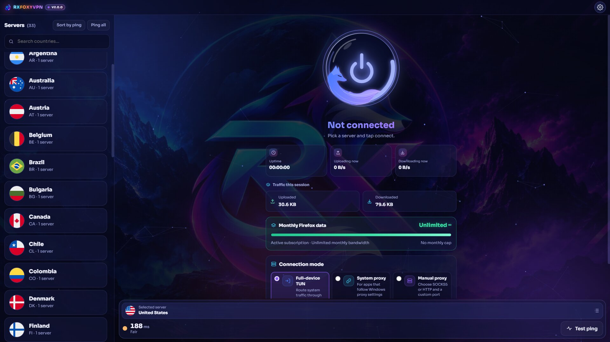
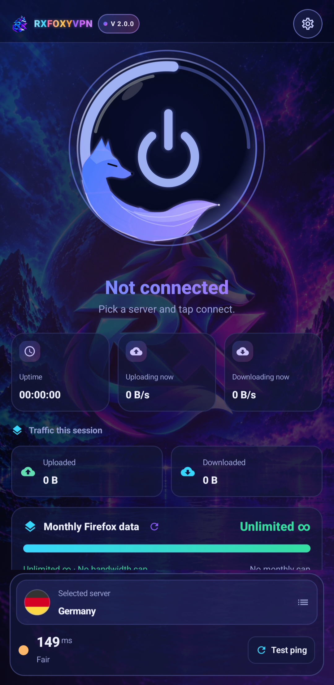
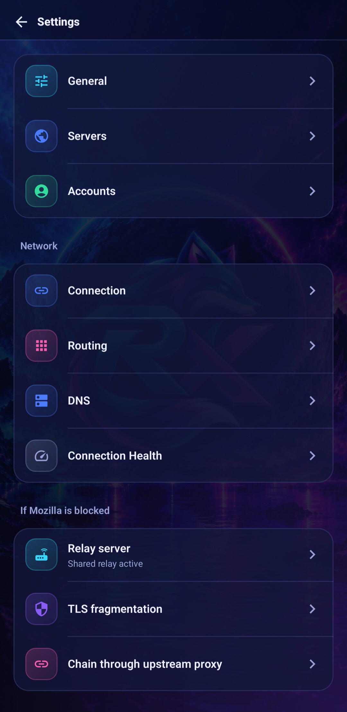

<div align="center">


# RXFoxyVPN

**你的自由，我们的优先。**

一款快速、简洁、支持多语言的 **Android** 与 **Windows** VPN 客户端。

<br>

[](https://github.com/omidrx0/RxFoxyVPN/releases/tag/V2.0.0)
[](https://github.com/SagerNet/sing-box)
[](https://github.com/omidrx0/RxFoxyVPN/releases/tag/V2.0.0)
[](https://github.com/omidrx0/RxFoxyVPN/releases/tag/V2.0.0)
[](https://github.com/omidrx0/RxFoxyVPN/releases/tag/V2.0.0)
[](https://github.com/omidrx0/RxFoxyVPN)
[](https://github.com/omidrx0/RxFoxyVPN)

<br>

[**下载**](https://github.com/omidrx0/RxFoxyVPN/releases/tag/V2.0.0) · [源代码](https://github.com/omidrx0/RxFoxyVPN)

[English](../README.md) · [فارسی](README.fa.md) · [Русский](README.ru.md) · **简体中文** · [한국어](README.ko.md) · [العربية](README.ar.md)

</div>

---

## 简介

RXFoxyVPN 是面向 **Android** 和 **Windows** 的跨平台项目，拥有简洁统一、支持你所用语言的界面。本仓库包含源代码和文档；可直接使用的构建版本发布在 [GitHub Releases](https://github.com/omidrx0/RxFoxyVPN/releases/tag/V2.0.0) 页面。

### v2.0.0 更新内容
> **全新核心 · 全新体验 · 更好连接**

- **核心进化** — 应用核心全面迁移至 **Sing-box**，替换旧核心。提升性能与连接稳定性，支持高级 Sing-box 功能，并新增反审查（Anti-Censorship）系统。
- **智能账户管理** — 全新登录与认证系统，引入账户池（Account Pool）。当使用量达到 95% 阈值时自动切换账户，更好地管理容量与用量。
- **智能路由** — 支持按地区选择路由。可选择指定国家，使其流量直连（VPN 旁路）。
- **Android 界面重塑** — 设置页与服务器列表大幅重新设计，主页细节优化，整体体验更一致。
- **Windows 界面重设计** — 全面重设计 Windows 界面，视觉上更接近 Android 版本，跨平台体验更统一。
- **更好的用户体验** — 重写错误提示，技术错误转化为易懂信息，问题出现时提供更好引导。
- **稳定性与改进** — 修复多个旧版本问题，提升整体稳定性。

## 功能

| Android | Windows |
| --- | --- |
| 原生 VPN 服务，用于管理连接 | 桌面界面，集成系统托盘 |
| 主页、服务器列表和设置页面 | 桌面外壳中的 Web 界面 |
| 支持 Android 8.0 及以上版本 | 系统级 TUN 模式与系统代理支持 |

**双平台通用：** 界面支持英语、波斯语、俄语、简体中文、韩语和阿拉伯语。

> [!TIP]
> 连接遇到问题？可以自己 [**搭建个人中继**](relay/README.md)。

## 应用截图

### Windows

<div align="center">
  
</div>

### Android

最低支持版本：**Android 8.0**。

<div align="center">
  <table width="100%">
    <tr>
      <td align="center" width="33%"><a href="screenshots/Home.jpg"></a></td>
      <td align="center" width="33%"><a href="screenshots/Server%20list.jpg"></a></td>
      <td align="center" width="33%"><a href="screenshots/Settings.jpg"></a></td>
    </tr>
    <tr>
      <td align="center"><sub><b>主页</b></sub></td>
      <td align="center"><sub><b>服务器列表</b></sub></td>
      <td align="center"><sub><b>设置</b></sub></td>
    </tr>
  </table>
</div>

## 下载 · v2.0.0

请从 <a href="https://github.com/omidrx0/RxFoxyVPN/releases/tag/V2.0.0"><b>GitHub Releases</b></a> 获取最新构建，或选择适合你设备的安装包。

<table>
  <thead>
    <tr>
      <th align="center">平台</th>
      <th align="center">&nbsp;&nbsp;&nbsp;&nbsp;&nbsp;&nbsp;&nbsp;&nbsp;&nbsp;&nbsp;&nbsp;&nbsp;&nbsp;&nbsp;&nbsp;&nbsp;&nbsp;下载&nbsp;&nbsp;&nbsp;&nbsp;&nbsp;&nbsp;&nbsp;&nbsp;&nbsp;&nbsp;&nbsp;&nbsp;&nbsp;&nbsp;&nbsp;&nbsp;&nbsp;</th>
    </tr>
  </thead>
  <tbody>
    <tr>
      <td rowspan="5" align="center" valign="middle">
        <br>
        <sub>Android 8.0 及以上</sub>
      </td>
      <td align="center" valign="middle">
        <a href="https://github.com/omidrx0/RxFoxyVPN/releases/download/V2.0.0/app-universal-releaseV2.0.0.apk"></a><br>
        <b>不确定时的最佳选择。</b> ⭐<br><sub>适用于所有设备和架构。</sub>
      </td>
    </tr>
    <tr>
      <td align="center" valign="middle">
        <a href="https://github.com/omidrx0/RxFoxyVPN/releases/download/V2.0.0/app-arm64-v8a-releaseV2.0.0.apk"></a><br>
        新款手机和平板。<br><sub>64 位 ARM 处理器。</sub>
      </td>
    </tr>
    <tr>
      <td align="center" valign="middle">
        <a href="https://github.com/omidrx0/RxFoxyVPN/releases/download/V2.0.0/app-armeabi-v7a-releaseV2.0.0.apk"></a><br>
        较旧的 Android 设备。<br><sub>32 位 ARM 处理器。</sub>
      </td>
    </tr>
    <tr>
      <td align="center" valign="middle">
        <a href="https://github.com/omidrx0/RxFoxyVPN/releases/download/V2.0.0/app-x86_64-releaseV2.0.0.apk"></a><br>
        Intel/AMD 设备和模拟器。<br><sub>64 位。</sub>
      </td>
    </tr>
    <tr>
      <td align="center" valign="middle">
        <a href="https://github.com/omidrx0/RxFoxyVPN/releases/download/V2.0.0/app-x86-releaseV2.0.0.apk"></a><br>
        Intel/AMD 设备和模拟器。<br><sub>32 位。</sub>
      </td>
    </tr>
    <tr>
      <td rowspan="2" align="center" valign="middle">
        <br>
        <sub>Windows 10 及以上</sub>
      </td>
      <td align="center" valign="middle">
        <a href="https://github.com/omidrx0/RxFoxyVPN/releases/download/V2.0.0/RXFoxyVPN-Setup.exe"></a><br>
        <b>适用于 64 位电脑的标准安装程序。</b> ⭐<br><sub>创建快捷方式，卸载方便。</sub>
      </td>
    </tr>
    <tr>
      <td align="center" valign="middle">
        <a href="https://github.com/omidrx0/RxFoxyVPN/releases/download/V2.0.0/RXFOXYVPN-Windows.zip"></a><br>
        无需安装。<br><sub>解压 ZIP 后运行。</sub>
      </td>
    </tr>
  </tbody>
</table>

> [!TIP]
> 不确定需要哪种 Android 架构？请选择 **Universal**。如 Android 提示，请允许从浏览器或文件管理器安装应用。

> [!NOTE]
> 如果你看不到仓库或发行版，可能是访问受限，请联系维护者获取权限。

## 从源代码构建

<details>
<summary>展开构建说明</summary>

<br>

克隆仓库：

```bash
git clone https://github.com/omidrx0/RxFoxyVPN.git
cd RxFoxyVPN
```

- **Android**：在 Android Studio 中打开 `Android/` 目录，等待 Gradle 同步完成（所需 JDK 与 Android SDK 版本请查看 Gradle 配置），然后运行应用，或使用 *Build → Build APK(s)*。
- **Windows**：新版 Windows 应用使用 Go 编写。请查看仓库中的 Windows 源代码和构建说明，并按照项目配置准备 Go 与 Web UI 构建所需环境。

构建步骤可能因环境而异，请以仓库中的配置文件为准。

</details>

## 项目结构

```text
Android/    Android 应用（Kotlin / Gradle）
Windows/    Windows 应用（Go / Web 界面）
docs/       多语言 README 文件
```

## 参与贡献

欢迎提出建议、报告问题和提交 Pull Request。较大的改动请先创建 Issue，以便讨论方案。

## 许可

使用与再分发条款以仓库中的 `LICENSE` 文件为准。如无该文件，则作者保留所有权利。

---

<div align="center">

<sub>**RXFoxyVPN** · Android 与 Windows · [GitHub 仓库](https://github.com/omidrx0/RxFoxyVPN)</sub>

<sub><i>你的自由，我们的优先。</i></sub>

</div>
